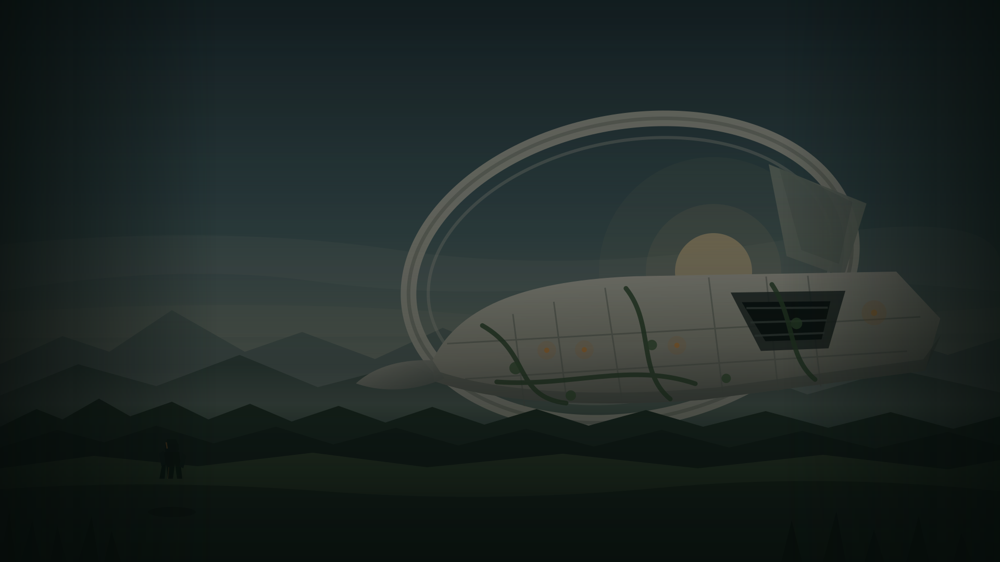

# Seed

A Godot 4.6 survival / colony game scaffolded from the [game-utils](https://github.com/huangyuan3h/game-utils) shared base.

You wake from the Eden system on a seeded planet, `SEED-2338 III`, with a broken ship,
a handful of sleepers, and one question: **can people learn to live here?**



## Documentation

Start with [`docs/README.md`](docs/README.md). It is the index for story, design,
current state, roadmap, and agent rules.

- [`docs/STATE.md`](docs/STATE.md) — what is implemented now
- [`docs/ROADMAP.md`](docs/ROADMAP.md) — milestones and ready tasks
- [`docs/AGENTS.md`](docs/AGENTS.md) — how to work in this repo
- [`docs/story.md`](docs/story.md) — story canon
- [`docs/story-spine.md`](docs/story-spine.md) — four-act narrative spine
- [`docs/story-timeline.md`](docs/story-timeline.md) — 180-year timeline and causal chain
- [`docs/cast.md`](docs/cast.md) — names, personalities, relationships
- [`docs/chapter-1-tools.md`](docs/chapter-1-tools.md) — chapter 1 tools, wrist printer, first tree
- [`docs/factory-loop.md`](docs/factory-loop.md) — simplified factory: materials, roads, steam/electric/field fleet, tech
- [`docs/materials-and-industry.md`](docs/materials-and-industry.md) — material ladder, salvage, mining
- [`docs/ship-energy.md`](docs/ship-energy.md) — 0.4c energy, beam road, reactor
- [`docs/ship-structure.md`](docs/ship-structure.md) — ship sections, scenes, modular model kit
- [`docs/art-direction.md`](docs/art-direction.md) — palette, shapes, lighting, asset pipeline
- [`docs/DECISIONS.md`](docs/DECISIONS.md) — locked decisions

## Playable now (graybox)

- 300 m procedural landing site with a flat play centre, dawn sky/fog, layered
  meadow and forest, and a distant ring-wreck silhouette.
- Animated `GuPlayer`, styled guide NPC, framed hibernation pods, and a vector
  title key art.
- **Pod 07** anomaly: empty hibernation pod, data chip, three dialogue entries.
- **Hunger loop**: hunger bar, wild berries, `H` to eat, AI threshold hints.
- **Shelter + thermal generator** build sites; wood/fiber harvest nodes.
- **Locked geneticist pod** with wake requirements (generator, power, shelter,
  food, med bay).
- **Ship blockout previews**: `scenes/ship/ship_preview.tscn` (connected cryo bay,
  med bay, corridor, sealed energy door) and `scenes/ship/ship_exterior_preview.tscn`
  (1.28 km crashed hull + breach ramp). Props respond to `E`, and the airlock/breach
  switch between interior and exterior. The landing-site wreck also has a
  `ShipEntry` transition into the interior preview.

This is still a graybox. There is no 4 km map, ocean, research lab, farming,
NPC schedule, or fleet yet. See `docs/STATE.md` for the full list.

## Controls

- **WASD / Arrows**: move relative to the camera
- **Shift**: toggle run
- **Space**: strike
- **E**: interact
- **1–6**: select hotbar slot
- **F**: use selected item / tool action
- **H**: eat a wild berry
- **I**: wrist computer → PACK (inventory)
- **T**: wrist computer → ARCHIVE (tech)
- **Tab**: wrist computer (opens PACK)
- **Scroll / `+` `-`**: camera zoom
- **ESC**: close wrist → pause / save / settings
- **`` ` ``**: dev console

## Commands

```bash
GU=/Users/huangyuan/Projects/game-utils/start.sh
SEED=/Users/huangyuan/Projects/seed

$GU play   --project "$SEED"
$GU play   --project "$SEED" --editor
$GU check  --project "$SEED"
$GU addons sync --target "$SEED" --prune
$GU export --preset macOS --out "$SEED/build/macos/seed.zip"

# Ship blockout previews
/Applications/Godot.app/Contents/MacOS/Godot --path "$SEED" res://scenes/ship/ship_preview.tscn
/Applications/Godot.app/Contents/MacOS/Godot --path "$SEED" res://scenes/ship/ship_exterior_preview.tscn

# Regenerate ship models + scenes
blender -b --python "$SEED/tools/blender/build_ship_models.py" -- all
python3 "$SEED/tools/godot/generate_ship_scenes.py"
```

Use absolute paths: `gu` resolves relative paths against `game-utils/shell/`, not your
shell's current directory.

## Shared base

Scaffolded from game-utils at `v0.2.0` (`d50ea22`). game-utils remains the source of
truth for the shared addons and tooling.

`addons/gu_core` and `addons/gu_gameplay` are **copies**. Do not edit them here:
`gu addons sync --prune` overwrites them. Seed-specific code belongs in `scripts/` and
`scenes/`; reusable changes go into game-utils `godot/addons/`, then are synced back.

## Layout

```
addons/        read-only shared plugins
data/          content tables + localization
docs/          story, design, state, roadmap, agent rules
scenes/        main graybox + world interactables
scripts/       Seed coordinator, survival, colony, world
tests/         headless assertions
```
