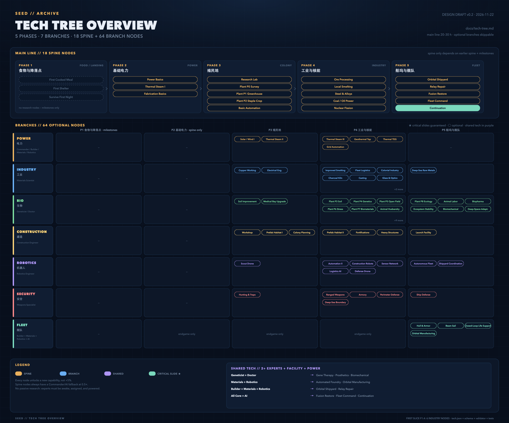

# Seed — 科技树总纲

> 状态：设计草案 v0.2 · 2026-11-22
>
> 定位：科技树的**统一总纲**。本文件定义 5 个阶段、7 条分支、主线/支线节点、百分比权重、共同科技、玻璃薄片映射、数据模型和实现顺序。
> `plant-branch.md` 的 P0–P8、`factory-loop.md` 的 6 个工业节点、`thermal-power.md` 的电力节点，都是本文件的分支展开；若与本文件冲突，以本文件为准（待作者确认）。
>
> 关联文档：[`design.md`](design.md) · [`story.md`](story.md) · [`tech-archive.md`](tech-archive.md) · [`plant-branch.md`](plant-branch.md) · [`factory-loop.md`](factory-loop.md) · [`thermal-power.md`](thermal-power.md) · [`colonist-wake-chain.md`](colonist-wake-chain.md) · [`materials-and-industry.md`](materials-and-industry.md) · [`ui-hud.md`](ui-hud.md)
>
> 阅读顺序：先看 §3 的全图；实现 F1.4 看 §9.2 / §10 / §12；写某条分支看 §4 / §6；改共同科技看 §4.6 / §7；改货仓薄片看 §8。



> 图源：`diagrams/tech-tree-overview.svg`。上图只画主线与代表性支线节点；完整 82 个节点见 §5–§6。

## 1. 为什么需要一份总纲

现有设计已经把科技树的“骨架”分散写好，但没有一张全图：

| 已有设计 | 内容 | 缺口 |
|----------|------|------|
| `design.md` §6 | 5 阶段、百分比、专家分支、共同科技 | 只有原则，没有完整节点 |
| `plant-branch.md` | 植物 P0–P8 | 只覆盖基因专家的 1/4 分支 |
| `factory-loop.md` §10 | 工业 6 节点 vertical slice | 只覆盖第三幕的一小段 |
| `thermal-power.md` §4 | 电力 6 节点 | 未接入总树，也没有跨分支前置 |
| `tech-archive.md` | 玻璃薄片、货仓、终局 | 没有薄片到节点的完整映射 |
| `colonist-wake-chain.md` | 5+1 阵容、每人 >3 分支 | 只列出分支名，没有节点 |

由此产生四个问题：

1. **分支不完整**：建造、机器人、武器、动物、微生物、生态、医疗、改造、舰队几乎只有一句设定。
2. **主线与支线混在一起**：5 阶段 × 3–5 个关键节点，装不下 5+1 专家的全部分支。
3. **没有统一规则**：百分比怎么加、共同科技怎么卡、薄片缺了怎么办、专家死了怎么办，各文档各说各的。
4. **无法落地**：没有 `tech.json` 字段、没有测试标准、没有实现顺序。

本文把这些问题一次补齐。核心数字：

- **5 个阶段**
- **7 条 UI 分支**
- **18 个主线节点 + 64 个支线节点（约 82 个）**
- **20–30 小时主线只要求 18 个主线节点，支线可跳过**

> 82 是 v0.1 的完整目标；第一版只做 `factory-loop.md` 的 6 节点切片，不要求一次做完。

## 2. 锁定约束

以下决定不在本文重新讨论，只把它们落成可执行的节点规则：

| 约束 | 来源 | 在科技树里的体现 |
|------|------|------------------|
| 玩家只控制指挥官，其他殖民者是自主 NPC 专家 | D005 | 专家不“被操作”，只被唤醒、分配设施、决定优先级 |
| 每位专家拥有 3+ 分支；2+ 专家解锁共同科技 | D006 | `owners` / `shared` / `min_owners` |
| 没有彩色科技瓶；进度来自里程碑、图纸、样本、原型、人 | D010 | `sources` 权重，不使用“科技点”货币 |
| 科技树是货仓里的玻璃薄片，不是抽象菜单 | D007 / D021 | `slides` / `ArchiveState` / 残片与重建 |
| 飞船很大，货仓、舰桥、工程舱是后续空间 | D013 | 档案按舱段分段开放 |
| 热能发电机 20 是启动钥匙，不是电厂 | D024 | 电力节点分 Tier，20 只够 Phase 2 |
| 物流是道路 + 无人车队，不是传送带 | D031 | 工业节点解锁矿机/道路/物流站/车辆 |
| 没有“唯一的植物学家” | `design.md` §6.3 | 植物节点可由基因专家 + 设施 + AI 共同推进 |
| 核心队员都是可靠小队成员 | D015 | 没有“专家背叛导致科技树毁掉”的随机事件 |
| 终局是继续任务，不是返航 | D020 | 舰队分支以“轨道船坞 + 光路 + 继续”收束 |

## 3. 体系总览

### 3.1 五个阶段

| 阶段 | 名称 | 玩家目标 | 主线节点 | 退出条件 | 目标时长 |
|------|------|----------|----------|----------|----------|
| 1 | 食物与降落点 | 第一顿饭、第一夜 | 无（只有生存里程碑） | 熟食 + 庇护 + 水源 + 撑过第一夜 | 0–1 h |
| 2 | 基础电力 | 让飞船再醒一次 | 3 | 20 电 + AI L1 + 工作台 + 可唤醒基因专家 | 1–3 h |
| 3 | 殖民地 | 让这里能住人 | 5 | 研究所 + 温室 + 第一顿自产食物 + 工厂切片启动 | 3–9 h |
| 4 | 工业与核能 | 重建文明 | 5 | 钢 + 煤/油电 + 核裂变 + 4–5 名专家 + 找到 Vale | 9–20 h |
| 5 | 船坞与舰队 | 继续任务 | 5 | 轨道船坞 + 光路 + 聚变 + 舰队指挥 + 终局选择 | 20–30 h |

**第一阶段没有科技节点。** 玩家在 Phase 1 采集的种子、土壤、矿石露头、旧设施坐标，会在 Phase 2–4 变成 `samples` / `data` / `old_facility` 进度来源。这样“先活下来”不会被科技菜单打断。

### 3.2 七条分支

UI 只显示 7 条一级分支（与 `ui-hud.md` §9 对齐），子分支在节点详情里展开。

| 分支 | UI 名 | 主 owner | 副 owner | 子分支 | 这条分支回答什么 |
|------|-------|----------|----------|--------|------------------|
| Power | `POWER` | 指挥官 / 建造 / 材料 / 机器人 | AI | 热能、可再生、煤/油、地热、核/聚变 | 电从哪来，够不够 |
| Industry | `INDUSTRY` | 材料学家 | 建造 / 机器人 / 指挥官 | 采矿、冶金、制造、化工 | 材料从哪来，能不能规模化 |
| Bio | `BIO` | 基因专家 | 医生 / AI | 植物、动物、微生物、生态、医疗 | 怎么吃饱和住下来 |
| Construction | `CONSTRUCTION` | 建造工程师 | 材料 / 指挥官 | 住房、结构、规划、工事 | 殖民地能不能接住更多人 |
| Robotics | `ROBOTICS` | 机器人工程师 | 材料 / 建造 / AI | 无人机、自动化、物流、AI 硬件、传感器 | 怎么让机器接管重复/危险工作 |
| Security | `SECURITY` | 武器专家 | 建造 / 机器人 | 狩猎、武器、防御、边界、军械 | 怎么守住殖民地和深海边界 |
| Fleet | `FLEET` | 建造 + 材料 + 机器人 | 全部核心 + AI | 中继、船坞、船体、推进、生命维持、指挥 | 怎么继续任务 |

**专家归属：**

| owner id | 角色 | 拥有的分支 | 唤醒后主要影响 |
|----------|------|------------|----------------|
| `commander` | 玩家 / 指挥官 | Power 基础、Industry 制造、Phase 1 生存里程碑 | 前期唯一能推进的人 |
| `geneticist` | Sana Ahn / 基因专家 | Bio：植物、动物、微生物、生态 | 食物、生态、生物材料 |
| `construction_engineer` | Tomas Rook / 建造工程师 | Construction | 住房、工坊、研究所、工事 |
| `materials_scientist` | Lin Qiao / 材料学家 | Industry：冶金、复合材料、3D 打印、装甲 | 矿冶、合金、核电材料 |
| `robotics_engineer` | Juno Park / 机器人工程师 | Robotics | 无人机、自动化、AI 硬件、物流 |
| `weapons_specialist` | Vale / 武器专家 | Security | 狩猎、军械、防御、边界 |
| `doctor` | Yusuf Erdem / 医生（可选） | Bio：医疗、辐射、改造恢复 | 医疗、基因治疗、义体 |
| `ai` | Mira / 船载 AI | 不拥有分支 | 只提供 `data` / `ai` / `old_facility` 进度与共同科技协调 |

> **AI 不拥有科技分支。** 它不能代替专家完成 `expert` 来源，只能提供数据、分析、协调和自动化能力。这保证“人仍然是科技树的一部分”。
>
> 这些 `owner id` 就是未来 `colonists.json` 的 `id`；`role` / `display_name` 另存，不要在 `tech.json` 里写人名。

### 3.3 主线节点 vs 支线节点

| 类型 | `kind` | 数量 | 规则 | 例子 |
|------|--------|------|------|------|
| 主线节点 | `spine` | 18 | 每阶段 3–5 个；必须完成才能进入下一阶段；只依赖更早的主线节点、里程碑、设施 | `power_basics`、`plant_p2_staple_crop`、`nuclear_fission_1` |
| 支线节点 | `branch` | ~64 | 专家分支、共同科技、玩法扩展；可跳过；不能反过来卡主线 | `thermal_steam_3`、`animal_husbandry_1`、`fleet_logistics` |

**“宽而浅”的落地方式：**

- **主线窄**：18 个节点，20–30 小时一周目必须能走完。
- **支线宽**：64 个节点，给不同专家组合、探索顺序和玩法偏好留空间。
- **每个节点改变一件玩家能做的事**，不是 +5% 数值。
- 支线可以加速主线，但不能成为主线的前置。

### 3.4 主线依赖图

```
Phase 2
  power_basics ──> thermal_steam_1
       │
       └──> fabrication_basics ──> research_lab
                                      │
Phase 3                               ├──> plant_p0 ──> plant_p1 ──> plant_p2
                                      │
  fabrication_basics ──> basic_automation

Phase 4
  basic_automation ──> ore_processing_1 ──> smelting_1 ──> steel_1
                                                   │
                                                   └──> coal_power_1
                                      steel_1 + coal_power_1 ──> nuclear_fission_1

Phase 5
  nuclear_fission_1 ──> orbital_shipyard ──> relay_repair_1
                                │
                                └──> fusion_restore
  orbital_shipyard + fusion_restore + 找到 Vale ──> fleet_command_1
  fleet_command_1 + relay_repair_1 ──> continuation_1
```

> `launch_facility_1`、`heavy_structures_1`、`hull_armor_1`、`beam_sail_1` 等是**支线增强**，不在主线依赖图里。主线只要求“发射场选址/地基”这个里程碑，不要求玩家点完建造支线。

## 4. 节点规则

### 4.1 ID 与命名

- 全部 `snake_case`，一旦进入 `tech.json` **不再改名**；显示名走 `display_name` + `ui_i18n.csv`。
- 植物沿用已有 ID：`plant_p0_seed_survey` … `plant_p8_ecology`。
- 电力、材料等已有 ID 保持不变：`power_basics`、`thermal_steam_1`、`smelting_1`、`steel_1` 等。
- 新节点用 `<branch>_<semantic>` 或 `<branch>_<sub>_<n>`：
  - `ore_processing_1`
  - `prefab_habitat_2`
  - `animal_husbandry_1`
  - `orbital_shipyard`
- 薄片用 `slide_<branch>_<nn>`：`slide_power_01`、`slide_bio_02`。
- 里程碑 flag 用 `<verb>_<noun>`：`research_bench_built`、`first_staple_harvest`。
- 设施用 `<name>_1`：`research_lab_1`、`foundry_1`、`shipyard_1`。

### 4.2 节点字段

| 字段 | 类型 | 必填 | 说明 |
|------|------|------|------|
| `id` | string | 是 | 唯一、稳定、snake_case |
| `display_name` | string | 是 | 英文 key，中文放 `ui_i18n.csv` |
| `description` | string | 否 | 一句能力描述，不写数值 |
| `phase` | int | 是 | 1–5，对应 §3.1 |
| `branch` | string | 是 | 7 条一级分支之一 |
| `sub_branch` | string | 否 | `plant` / `metallurgy` / `drones` … |
| `tier` | int | 否 | 分支内深度 1–5，用于 UI 排序 |
| `kind` | string | 是 | `spine` 或 `branch` |
| `owners` | array | 是 | 可推进的专家 id；`shared` 时是参与者池 |
| `shared` | bool | 否 | 默认 `false` |
| `min_owners` | int | 否 | 仅 `shared`；默认等于 `owners` 数量 |
| `fallback_owners` | array | 否 | 主线软锁保险；通常 `["commander"]`，速度 0.5× |
| `requires` | array | 否 | 前置节点 id；只写节点，不写里程碑 |
| `facility` | array | 否 | 推进所需设施 id |
| `sources` | array | 是 | 进度来源，权重总和必须 100 |
| `slides` | array | 否 | 对应薄片 id |
| `slide_bonus` | int | 否 | 完整薄片额外加成百分比，默认 25；不占 100 权重 |
| `grants_full` | bool | 否 | 完整薄片是否直接解锁低阶节点 |
| `slide_policy` | string | 否 | `critical` / `optional` / `none` |
| `unlocks` | array | 是 | 至少 1 项；见 §4.7 |
| `tags` | array | 否 | `story` / `optional` / `endgame` / `hidden` |
| `hidden_until` | string | 否 | 未满足时显示 `???`；例如 `ai_level:2` |

### 4.3 节点状态

与 `ui-hud.md` §9.4 对齐，并补一个“缺零件”状态：

| 状态 | 条件 | UI |
|------|------|----|
| `unknown` | `hidden_until` 未满足 | 虚线 + `???` |
| `fragment` | 找到部分薄片/数据，但缺专家/设施/前置 | 半亮 + 百分比 |
| `available` | 前置满足，可设为目标 | 琥珀色实线 |
| `in_progress` | 已设为目标，至少一个来源在涨 | 冰蓝色 + 进度 |
| `blocked_parts` | 研究台缺零件 | 冰蓝色 + `Need: Mechanical Parts` |
| `blocked_power` | 设施电力不足 | 冰蓝色 + `Power 60%` |
| `locked_person` | `owners` 未醒/未找到（主线有 `fallback_owners` 时不显示为锁定） | 灰色 + 人头像 |
| `locked_facility` | `facility` 未建 | 灰色 + 建筑图标 |
| `complete` | 100% | 青绿色 + ✔ |

状态优先级：`complete` > `in_progress` > `blocked_*` > `available` > `locked_*` > `fragment` > `unknown`。

### 4.4 进度来源

每个节点由 2–5 个来源组成，权重总和 **100**。来源不是“科技点”，而是玩家实际做的事。

| 代码 | `type` | 什么时候给进度 | 是否一次性 | 典型权重 |
|------|--------|----------------|------------|----------|
| M | `milestone` | 工程/剧情里程碑达成 | 是 | 20–50 |
| D | `data` | 扫描飞船日志、终端、旧记录 | 是 | 10–40 |
| S | `sample` | 采集并分析 N 份样本 | 按数量比例 | 20–50 |
| P | `prototype` | 造出测试件并验证 | 是 | 20–40 |
| C | `colony` | 人口/电力/食物/建筑达到阈值 | 是 | 20–40 |
| E | `expert` | 指定专家醒来、分配设施、设施有电，持续工作 | 连续，封顶 | 20–40 |
| R | `parts` | 研究台消耗机械件/电气件等 | 按投入数量 | 30–50 |
| X | `old_facility` | 扫描旧播种设施/沉船/前哨 | 是 | 20–40 |
| A | `ai` | AI 分析等级达到要求 | 是 | 10–20 |

**薄片不占 100% 权重。** 薄片是额外加成：读取完整薄片给 `slide_bonus`（默认 25%），残缺给一半（12.5%），直接加到节点进度上，总数封顶 100%。低阶节点可设 `grants_full: true`，完整薄片直接解锁。这样 `sources` 仍然总和 100，UI 能同时显示“来源贡献”和“薄片加成”。

**硬规则：**

- 没有任何“全局被动研究”。不打开游戏、不分配专家、不投零件，进度不涨。
- `E` 不是挂机：专家必须醒来 + 被分配到设施 + 设施有电 + 没有更优先任务。专家在种地/建造时不会同时研究。
- `R` 必须主动投入；零件不够就停在当前百分比。
- `S` / `R` 按数量比例给进度，不四舍五入到 0。
- 所有来源在 UI 里必须可见，不能有隐藏加成。

### 4.5 百分比计算

```
node_progress = min(100, Σ min(source_progress_i, weight_i) + slide_bonus)
Σ weight_i = 100
```

示例：`basic_automation`

| 来源 | 权重 | 玩家状态 | 贡献 |
|------|------|----------|------|
| M：建好研究台 | 30 | 已完成 | 30 |
| D：扫描飞船工程缓存 | 20 | 已完成 | 20 |
| R：投入 10 个机械件 | 50 | 已投 4 个 | 20 |
| **合计** | **100** | | **70%** |

- 10 个机械件 = 50%；每个 5%。如果节点成本改成 20 个，每个 2.5%。
- 专家来源：`weight / expert_work_units` 每分钟增加；`expert_work_units` 在数据里配置，按设施等级和专家专长修正。
- 多个专家参与同一节点：普通节点由 owner 各自贡献；共同节点的 `E` 权重由在场 owner 均摊，非 owner 不填。
- 难度不改变权重，只改变 `expert_work_units` / `parts` 数量；这样 UI 的“来源百分比”始终可解释。

### 4.6 专家、共同科技与软锁

**普通节点（`shared: false`）：**

- `owners` 里任意一人可推进；其他 owner 醒来后提供 +25% 专家速度（不改变权重）。
- 没有 owner 时，`fallback_owners`（通常是指挥官）可以 0.5× 速度推进，但不能获得该分支的专属解锁加成。

**共同节点（`shared: true`）：**

- `owners` 是可参与的专家池；`min_owners` 是**最低在场人数**，默认等于 `owners.size()`。
- 在场的 owner 必须：醒来 + 被分配到有效设施 + 设施有电。
- `E` 权重由**在场的 owner 均摊**；在场人数 ≥ `min_owners` 才计入进度，低于门槛则暂停，已经获得的百分比**不重置**。
- 达到 `min_owners` 后，缺席 owner 不阻塞完成；他们的份额由在场 owner 分摊（不再额外乘算）。
- 参与的 owner 越多，`E` 份额涨得越快，但有上限；共同节点不额外乘算，避免叠加爆炸。
- 某个 owner 永久死亡/离队：
  - 支线共同节点：显示 `Missing: <name>`；可通过 `fallback_owners` 或旧设施数据以 0.5× 重建。
  - 主线共同节点：必须提供 `fallback_owners`，否则不允许标记为 `spine`（见 §4.8）。
- **“全部核心” = Sana、Tomas、Lin、Juno、Vale 五人**；医生是可选的第 6 人，不计入“全部核心”。

**医生与 Vale 的特殊处理：**

- 医生是可选第 6 人。涉及医生的节点设置 `min_owners` 低于 `owners.size()`，或把基因专家/AI 放入 `fallback_owners`，保证没有医生也能通关。
- Vale 在 Phase 4 主线被找到；`fleet_command_1` 需要“全部核心 + AI”。如果作者决定 Vale 不可救，则把 `fleet_command_1` 的 `owners` 改为其余 4 名核心 + AI，并在剧情里给出替代。

### 4.7 解锁类型

每个节点至少 1 个 `unlocks`，且必须改变玩家能做的事。

| `type` | 例子 | 说明 |
|--------|------|------|
| `building` | `miner`、`greenhouse`、`nuclear_reactor` | 新可建造物 |
| `facility` | `research_lab_2`、`medbay_2` | 设施升级 |
| `recipe` | `iron_plate`、`electrical_part` | 新配方 |
| `item` | `glass`、`steel` | 新物品 |
| `vehicle` | `steam_truck`、`electric_truck` | 新载具 |
| `tool` | `axe`、`drill` | 新工具 |
| `ability` | `ai_analysis_1`、`gene_editing` | 新能力/动词 |
| `rule` | `shared_tech`、`route_priority` | 新系统规则 |
| `ui` | `archive_panel`、`power_panel` | 新 UI |
| `narrative` | `continuation_choice` | 终局/剧情选择 |

**反模式：**

- `unlocks` 为空：不允许。
- 只有 `+5% 采矿速度`：不允许；效率节点必须同时改变瓶颈决策（燃料、副产物、配方、容量 tier）。
- `factory-loop.md` 的“改良冶炼 +50% 速度”是 vertical slice 占位；正式节点应同时解锁燃料效率/炉渣利用/新配方，而不是纯数值。

### 4.8 主线闭合与软锁规则

这是整套体系最重要的规则：

1. **主线只依赖主线。** `spine` 节点的 `requires` 只能引用更早的 `spine` 节点；里程碑/设施/专家醒来条件放在 `sources` / `facility` / `owners`，不能引用 `branch` 节点。
2. **支线可以依赖主线或支线。** `branch` 节点可以要求 `spine`，但 `spine` 不能反过来要求 `branch`。
3. **主线节点必须有 `fallback_owners`。** 默认 `["commander"]`；终局节点可以是 `["commander", "ai"]`。这保证玩家即使唤醒了“错误”的专家，也能以更慢速度推进主线。
4. **每个阶段有退出条件。** 未满足退出条件时，下一阶段主线节点显示 `Locked by milestone`，不靠隐藏等级。
5. **关键薄片保证生成。** `slide_policy: critical` 的薄片至少有一个确定性获取点；不依赖随机掉率。
6. **不出现“唯一且可错过”的专家。** 除 Vale 是主线搜救外，其他专家都在休眠舱区，玩家可以随时回去唤醒。
7. **任何永久性损失都可重建。** 薄片碎了可修，设施毁了可重建，专家离队可用 `fallback_owners` 或旧设施数据以 0.5× 推进。
8. **不允许“科技树毁掉”式失败。** 最坏情况是进度变慢，不是主线永久锁死。

### 4.9 玻璃薄片规则

- 薄片是**物品**，不是菜单：可以在货仓拾取、携带到读取器、插入档案终端。
- 读取需要：档案终端 + 电力 + AI L1。
- `ARCHIVE` 远程视图只读；投入零件/改目标必须在研究台或档案终端。
- 薄片状态：

| 状态 | 进度贡献 | 说明 |
|------|----------|------|
| `intact` | 100% 的 `L` 权重 | 直接读取 |
| `partial` | 50% 的 `L` 权重 | 缺页/裂片，专家可补全剩余 |
| `damaged` | 0%，修复后变 `partial` | 需要材料 + 研究所/工坊修复 |
| `missing` | 0% | 节点仍可只靠专家/数据/零件推进 |

- 完整薄片可以**直接解锁**一个低阶节点（`grants_full: true`）；高阶节点即使有完整薄片，也需要专家/设施验证。
- 重复薄片可以转换为：10% 的 `D` 进度、备用零件、或交易/研究样本；不能无限刷。
- 关键薄片不随机消失；`slide_policy: critical` 至少有一个主 quest 获取点。

## 5. 主线节点（18）

> 进度来源列使用 §4.4 的代码；权重是默认值，最终在 `tech.json` 中配置并校验总和 100。
> “前置”列混合展示节点、设施和里程碑；只有节点 id 写入 `requires`，里程碑/样本/旧设施写入 `sources`，设施写入 `facility`。
> `★` = 关键薄片（保证生成）；`○` = 可选薄片；`–` = 无薄片。
>
> **两个“研究台”不是同一个东西：** `research_bench` 是 F1.4 的工业研究台（投零件、解锁科技）；`research_lab` 是 M3 基因专家研究所（分析样本、推进植物分支）。

### 5.1 Phase 1 生存里程碑（不是科技节点）

| 里程碑 flag | 触发 | 作用 |
|-------------|------|------|
| `first_cooked_meal` | 第一次生火 + 烹饪 | 给 Phase 2 节点提供 `M` 进度；AI 开始评论食物 |
| `first_shelter` | 简易房屋/庇护建成 | 解锁基因专家唤醒条件；给 `research_lab` 提供 `M` |
| `water_source_found` | 找到并净化水源 | 热能发电机、温室、医疗的 `M` |
| `first_night_survived` | 撑过第一夜 | 给 `power_basics` 提供 `M`；AI L1 前置 |
| `pod_07_investigated` | 调查 07 号舱 | 给 `D` 数据；开启 Vale 线索 |

Phase 1 不显示 `ARCHIVE`；AI 在 `power_basics` 完成后才解锁档案界面。

### 5.2 Phase 2–5 主线

| 阶段 | ID | 名称 | Owners | 前置 | 进度来源（默认） | 解锁 | 薄片 |
|------|----|------|--------|------|------------------|------|------|
| 2 | `power_basics` | 基础电力 | `commander` | – | M40 / D30 / P30 | 电网面板、接线、负载优先级、安全断电 | ★ `slide_power_01` |
| 2 | `thermal_steam_1` | 热能发电机 I | `commander` | `power_basics` | M30 / D40 / P30 | 热能发电机、锅炉、蒸汽回路、充电 | ★ `slide_power_01` |
| 2 | `fabrication_basics` | 基础制造 | `commander` | `power_basics` | M40 / D30 / P30 | 工作台、研究台、打印队列、工具头、维修件 | ★ `slide_industry_01` |
| 3 | `research_lab` | 研究所 | `commander`、`construction_engineer` | `fabrication_basics`、`power_basics` | M50 / R30 / E20 | 研究所、分析台、基因实验室接口 | ★ `slide_construction_01` |
| 3 | `plant_p0_seed_survey` | 种子库调查 | `geneticist` | `research_lab`、基因专家醒来 | S40 / D20 / A20 / E20 | 作物目录、温室图纸、样本分析 | ★ `slide_bio_01` |
| 3 | `plant_p1_greenhouse` | 温室 | `geneticist` | `plant_p0_seed_survey` | M50 / P25 / E25 | 温室地块、温控、第一批新鲜食物 | ○ `slide_bio_01` |
| 3 | `plant_p2_staple_crop` | 主粮作物 | `geneticist` | `plant_p1_greenhouse` | M30 / P40 / C30 | 主粮、食物储存、基础轮作 | ○ `slide_bio_01` |
| 3 | `basic_automation` | 基础自动化 | `commander`、`robotics_engineer` | `fabrication_basics`、`power_basics` | R50 / M30 / D20 | 矿机、道路、物流站、蒸汽运输车 | ★ `slide_industry_01` |
| 4 | `ore_processing_1` | 矿石加工 | `materials_scientist`、`construction_engineer` | `basic_automation` + 矿石样本 | M30 / S30 / P40 | 破碎机、选矿台、焙烧坑 | ★ `slide_industry_03` |
| 4 | `smelting_1` | 本地冶炼 | `materials_scientist`、`construction_engineer` | `ore_processing_1` + 耐火材料 | M30 / P40 / R30 | 冶炼炉、铁/铜锭、炉渣 | ★ `slide_industry_03` |
| 4 | `steel_1` | 钢与合金 | `materials_scientist` | `smelting_1` + 石灰石 | E30 / P40 / R30 | 钢、合金、船体修补 | ★ `slide_industry_04` |
| 4 | `coal_power_1` | 煤/油电力 | `materials_scientist`、`construction_engineer` | `smelting_1` + 煤/油露头 | M30 / R40 / E30 | 燃煤锅炉、燃油机组、烟气处理 | ★ `slide_power_02` |
| 4 | `nuclear_fission_1` | 核裂变 I | `materials_scientist`、`construction_engineer`、`robotics_engineer`（shared，min 2） | `steel_1`、`coal_power_1` | E20 / P30 / R30 / M20 | 裂变堆、辐射屏蔽、废料处理 | ★ `slide_fleet_01` |
| 5 | `orbital_shipyard` | 轨道船坞 | `construction_engineer`、`materials_scientist`、`robotics_engineer`（shared，min 2） | `nuclear_fission_1` + 发射场选址 | E30 / P40 / C30 | 轨道船坞、分段组装、起重 | ★ `slide_fleet_02` |
| 5 | `relay_repair_1` | 光路中继修复 | `construction_engineer`、`materials_scientist`、`robotics_engineer`（shared，min 2） | `orbital_shipyard` + 旧中继数据 | X30 / P40 / E30 | 中继站、光路校准、舰队通信 | ★ `slide_fleet_03` |
| 5 | `fusion_restore` | 聚变堆恢复 | 全部核心 + `ai`（shared，min 4） | `nuclear_fission_1`、`orbital_shipyard` + 氘 | D20 / P30 / E30 / R20 | 飞船聚变堆、氘燃料、主电力 | ★ `slide_fleet_04` |
| 5 | `fleet_command_1` | 舰队指挥 | 全部核心 + `ai`（shared，min 5） | `orbital_shipyard`、`fusion_restore`、找到 Vale | E30 / P30 / C40 | 舰队编成、护航、指挥 | ★ `slide_fleet_03` |
| 5 | `continuation_1` | 继续任务 | 全部核心 + `ai`（shared，min 5） | `fleet_command_1`、`relay_repair_1` | D30 / C30 / E40 | 终局选择、发射、知识交付 | ★ `slide_ai_01` |

> `fusion_restore`、`fleet_command_1`、`continuation_1` 是终局共同节点；它们的 `fallback_owners` 不能绕过“找到 Vale/全部核心”的剧情条件，但可以允许 0.5× 协调速度，避免玩家因为少唤醒一个可选专家而卡死。

## 6. 支线节点（约 64）

> 支线节点不阻塞阶段推进。主线节点已在 §5 列出，本节只列 `branch` 节点。
> 权重为默认值；来源列用代码简写；具体 `sources` 在 `tech.json` 中展开。

### 6.1 Power（6 支线）

| ID | 名称 | 阶段 | Owners | 前置 | 来源 | 解锁 | 薄片 |
|----|------|------|--------|------|------|------|------|
| `solar_wind_1` | 太阳能/风能 I | 3 | `commander`、`construction_engineer` | `thermal_steam_1` | M40 / D20 / P40 | 太阳能板、风机、电池组 | ○ `slide_power_02` |
| `thermal_steam_2` | 热能发电机 II | 3 | `construction_engineer`、`materials_scientist` | `thermal_steam_1` | E30 / R40 / P30 | 冷凝器、闭式水循环、泄压阀、调速器 | – |
| `thermal_steam_3` | 热能发电机 III | 4 | `robotics_engineer`、`construction_engineer` | `thermal_steam_2` | E30 / P40 / R30 | 自动加料、除灰、AI 监控、负载调节 | – |
| `geothermal_tap` | 地热接入 | 4 | `materials_scientist`、`construction_engineer` | `coal_power_1`、`ore_processing_1` | X30 / P40 / E30 | 地热换热、基荷电力 | ○ `slide_power_03` |
| `thermal_teg` | 热电模块 | 4 | `materials_scientist`、`robotics_engineer` | `thermal_steam_2`、`electrical_engineering` | E30 / P40 / R30 | TEG、余热发电、静音机组 | – |
| `grid_automation_1` | 电网自动化 | 4 | `robotics_engineer`、`ai` | `sensors_2`、`coal_power_1` | C30 / E30 / P40 | 负载优先级、AI 电网、故障预测 | ○ `slide_power_04` |

### 6.2 Industry（11 支线）

| ID | 名称 | 阶段 | Owners | 前置 | 来源 | 解锁 | 薄片 |
|----|------|------|--------|------|------|------|------|
| `copper_working` | 铜加工 | 3 | `materials_scientist` | `basic_automation` | R50 / M30 / D20 | 铜熔炼、电气件配方 | ○ `slide_industry_02` |
| `electrical_engineering` | 电气工程 | 3 | `materials_scientist`、`robotics_engineer` | `copper_working` | R50 / E30 / M20 | 发电机 II、电动运输车、充电站、AI 排线 | ○ `slide_industry_02` |
| `improved_smelting` | 改良冶炼 | 4 | `materials_scientist` | `smelting_1` | R40 / P30 / E30 | 燃料效率、炉渣利用、新配方 | – |
| `fleet_logistics` | 车队物流 | 4 | `robotics_engineer`、`commander` | `electrical_engineering`、`basic_automation` | R40 / M30 / E30 | 重型运输车、仓库、路线优先级、场充塔 | – |
| `colonial_industry` | 殖民地工业 | 4 | `construction_engineer`、`materials_scientist` | `basic_automation`、`electrical_engineering` | R40 / C30 / E30 | 建筑模块、研究台 II、殖民地建造 | ○ `slide_construction_02` |
| `charcoal_1` | 木炭窑 | 4 | `construction_engineer` | `power_basics` | M40 / P40 / D20 | 木炭窑、稳定燃料 | – |
| `casting_1` | 铸造 | 4 | `construction_engineer`、`materials_scientist` | `smelting_1` | P40 / R40 / E20 | 模具、铸件、管道/框架 | – |
| `glass_1` | 玻璃与光学 | 4 | `materials_scientist` | `smelting_1` + 砂/石灰 | S30 / P40 / R30 | 玻璃、容器、光学、温室玻璃 | – |
| `chemistry_1` | 化工 | 4 | `materials_scientist` | `coal_power_1` + 油苗 | M30 / S30 / P40 | 石油分馏、塑料、化肥、药品原料 | ○ `slide_industry_05` |
| `automated_foundry` | 自动化铸造 | 4 | `materials_scientist`、`robotics_engineer`（shared） | `smelting_1`、`electrical_engineering` | E30 / P40 / R30 | 自动化铸造、3D 打印产线 | ○ `slide_industry_05` |
| `rare_metals_1` | 深海稀有金属 | 5 | `materials_scientist`、`robotics_engineer` | `boundary_security_1`、`chemistry_1` | X40 / S30 / E30 | 深海结核、稀土、电子件 | – |

### 6.3 Bio（22 支线）

#### 6.3.1 植物 P3–P8

P0–P2 是主线，见 §5。完整节点、百分比来源和玩法影响见 [`plant-branch.md`](plant-branch.md) §4。

| ID | 名称 | 阶段 | Owners | 前置 | 来源 | 解锁 | 薄片 |
|----|------|------|--------|------|------|------|------|
| `plant_p3_soil` | 土壤改良 | 3 | `geneticist` | `plant_p2_staple_crop` | 见 `plant-branch.md` | 堆肥、灌溉、土壤健康 | – |
| `plant_p4_crop_genetics` | 作物基因 I | 4 | `geneticist` | `plant_p3_soil` + 基因实验室 | 见 `plant-branch.md` | 第一个作物性状、种子工程 | ○ `slide_bio_02` |
| `plant_p5_open_field` | 露天农业 | 4 | `geneticist` | `plant_p4_crop_genetics` | 见 `plant-branch.md` | 农田地块、轮作、生物防虫 | – |
| `plant_p6_stress` | 抗逆作物 | 4 | `geneticist` | `plant_p5_open_field` | 见 `plant-branch.md` | 耐寒/耐旱/耐盐/抗 UV | – |
| `plant_p7_biomaterials` | 生物材料与药用植物 | 4 | `geneticist` + `materials_scientist` | `plant_p6_stress` + 加工设施 | 见 `plant-branch.md` | 植物纤维、生物塑料、药用植物 | ○ `slide_bio_04` |
| `plant_p8_ecology` | 生态整合 | 5 | `geneticist` | `plant_p7_biomaterials` + 本地物种 | 见 `plant-branch.md` | 生态稳定、本地作物、病虫害抑制 | ○ `slide_bio_03` |

#### 6.3.2 动物

| ID | 名称 | 阶段 | Owners | 前置 | 来源 | 解锁 | 薄片 |
|----|------|------|--------|------|------|------|------|
| `animal_husbandry_1` | 畜牧 I | 4 | `geneticist` | `plant_p2_staple_crop` | S40 / M30 / E30 | 圈舍、兔/家禽驯养、粪肥 | ○ `slide_bio_03` |
| `animal_behavior_1` | 动物行为 | 4 | `geneticist` | `animal_husbandry_1` | S50 / E30 / P20 | 行为观察、驯化、疫病防控 | – |
| `animal_labor_1` | 役用动物 | 5 | `geneticist`、`construction_engineer` | `animal_behavior_1`、`ecology_survey_1` | E40 / P40 / C20 | 劳动力/坐骑、牧场 | – |

#### 6.3.3 微生物

| ID | 名称 | 阶段 | Owners | 前置 | 来源 | 解锁 | 薄片 |
|----|------|------|--------|------|------|------|------|
| `microbe_soil_1` | 土壤微生物 | 4 | `geneticist` | `plant_p3_soil` | S50 / P30 / E20 | 固氮/分解菌群、堆肥加速 | – |
| `fermentation_1` | 发酵 | 4 | `geneticist` | `microbe_soil_1`、`chemistry_1` | S40 / P40 / E20 | 食品保存、酒精/酸、饲料 | – |
| `biopharma_1` | 生物制药 | 5 | `geneticist`、`doctor` | `microbe_soil_1`、`medicine_basics_1` | S40 / P40 / E20 | 抗生素、疫苗、药用成分 | ○ `slide_bio_04` |

#### 6.3.4 生态

| ID | 名称 | 阶段 | Owners | 前置 | 来源 | 解锁 | 薄片 |
|----|------|------|--------|------|------|------|------|
| `ecology_survey_1` | 本地生态调查 | 4 | `geneticist` | `plant_p0_seed_survey` | S50 / D30 / E20 | 本地物种图鉴、传粉者、风险 | ○ `slide_bio_03` |
| `pollinator_1` | 传粉与树篱 | 4 | `geneticist` | `ecology_survey_1` | M40 / S30 / E30 | 传粉者栖息地、防风林 | – |
| `ecosystem_stability_1` | 生态稳定 | 5 | `geneticist`、`ai` | `plant_p8_ecology`、`pollinator_1` | C40 / S30 / E30 | 长期稳定、病虫害抑制、本地作物 | ○ `slide_bio_03` |

#### 6.3.5 医疗与改造

| ID | 名称 | 阶段 | Owners | 前置 | 来源 | 解锁 | 薄片 |
|----|------|------|--------|------|------|------|------|
| `medicine_basics_1` | 医疗室升级 | 3 | `doctor` | `power_basics` + 庇护 | M40 / R40 / E20 | 手术台、消毒、药品储存 | – |
| `radiation_medicine_1` | 辐射医学 | 4 | `doctor`、`materials_scientist` | `medicine_basics_1` | S40 / E30 / P30 | 辐射检测、治疗、防护 | – |
| `gene_therapy_1` | 基因治疗 I | 4 | `geneticist`、`doctor`（shared，min 1） | `plant_p4_crop_genetics`、`medicine_basics_1` | E30 / S30 / P40 | 遗传病治疗、辐射/毒素抗性 | ○ `slide_bio_04` |
| `bio_augmentation_1` | 医疗义体 | 4 | `doctor`、`geneticist`、`construction_engineer`（shared，min 2） | `gene_therapy_1`、`casting_1` | E30 / P40 / R30 | 义肢、器官替代、基础环境适应 | ○ `slide_bio_04` |
| `neural_interface_1` | 神经接口 | 4 | `doctor`、`robotics_engineer`、`ai`（shared，min 2） | `bio_augmentation_1`、`sensors_2` | E30 / P40 / R30 | 与 AI/无人机/飞船直连、远程操作 | – |
| `biomechanical_1` | 生物机械整合 | 5 | `geneticist`、`doctor`、`construction_engineer`、`robotics_engineer`（shared，min 2） | `neural_interface_1`、`steel_1` | E30 / P40 / R30 | 合成肌肉、强化骨骼、深海/真空适应 | – |
| `deep_space_adaptation_1` | 深空改造 | 5 | 全部核心 + `ai`（shared，min 4） | `biomechanical_1`、`fleet_command_1` | E30 / P40 / C30 | 长期航行身体改造 | ○ `slide_ai_01` |

### 6.4 Construction（7 支线）

| ID | 名称 | 阶段 | Owners | 前置 | 来源 | 解锁 | 薄片 |
|----|------|------|--------|------|------|------|------|
| `workshop_1` | 工坊 | 3 | `construction_engineer` | `fabrication_basics` | M40 / R40 / E20 | 工坊、模块组装 | – |
| `prefab_habitat_1` | 预制居住模块 I | 3 | `construction_engineer` | `workshop_1` | M40 / P40 / E20 | 模块化住房、实验室/工坊扩展 | ○ `slide_construction_01` |
| `colony_planning_1` | 殖民地规划 | 3 | `construction_engineer`、`ai` | `prefab_habitat_1` | C40 / M30 / E30 | 分区、道路规划、仓储、预警 | – |
| `prefab_habitat_2` | 预制居住模块 II | 4 | `construction_engineer`、`materials_scientist`（shared） | `prefab_habitat_1`、`steel_1` | E30 / P40 / R30 | 大型居住/生产模块、气候适应 | ○ `slide_construction_02` |
| `fortifications_1` | 防御工事 | 4 | `construction_engineer`、`weapons_specialist`（shared） | `colony_planning_1`、`steel_1` | E30 / P40 / M30 | 围墙、掩体、警报 | ○ `slide_security_01` |
| `heavy_structures_1` | 重型结构 | 4 | `construction_engineer`、`materials_scientist` | `steel_1`、`colony_planning_1` | E30 / P40 / R30 | 桥梁、堤坝、发射台地基 | – |
| `launch_facility_1` | 发射设施 | 5 | `construction_engineer`、`materials_scientist` | `heavy_structures_1`、`nuclear_fission_1` | E30 / P40 / C30 | 地面发射阵、光路阵列、轨道接口 | ○ `slide_fleet_02` |

### 6.5 Robotics（8 支线）

| ID | 名称 | 阶段 | Owners | 前置 | 来源 | 解锁 | 薄片 |
|----|------|------|--------|------|------|------|------|
| `scout_drone_1` | 侦察无人机 | 3 | `robotics_engineer` | `electrical_engineering`、`research_lab` | P40 / M30 / E30 | 侦察无人机、地图标记、AI 视觉 | ○ `slide_robotics_01` |
| `automation_2` | 自动化 II | 4 | `robotics_engineer`、`ai` | `basic_automation`、`scout_drone_1` | C30 / P40 / E30 | 自动农场、自动产线、AI L3 | ○ `slide_robotics_01` |
| `construction_robots_1` | 建造机器人 | 4 | `robotics_engineer`、`construction_engineer`（shared） | `prefab_habitat_1`、`automation_2` | E30 / P40 / R30 | 建造机器人、自动组装 | – |
| `sensors_2` | 传感器网络 | 4 | `robotics_engineer` | `scout_drone_1` | P40 / E30 / M30 | 传感器网络、AI L2/L4、远程监控 | ○ `slide_robotics_02` |
| `logistics_ai_1` | AI 物流 | 4 | `robotics_engineer`、`ai` | `fleet_logistics`、`sensors_2` | C30 / E30 / P40 | 路线建议、车队调度、仓库平衡 | ○ `slide_robotics_02` |
| `defense_drone_1` | 防御无人机 | 4 | `robotics_engineer`、`weapons_specialist`（shared） | `scout_drone_1`、`armory_1` | E30 / P40 / R30 | 巡逻/防御无人机 | ○ `slide_security_01` |
| `autonomous_fleet_1` | 自动车队 | 5 | `robotics_engineer`、`ai` | `logistics_ai_1`、`fleet_logistics` | C30 / P40 / E30 | 多车调度、重型车队、无人运输网 | – |
| `shipyard_coordination_1` | 船坞协调 | 5 | `robotics_engineer`、`ai`、`construction_engineer`（shared） | `orbital_shipyard`、`autonomous_fleet_1` | E30 / P40 / C30 | 船坞供应链、分段组装、发射调度 | ○ `slide_fleet_02` |

### 6.6 Security（6 支线）

| ID | 名称 | 阶段 | Owners | 前置 | 来源 | 解锁 | 薄片 |
|----|------|------|--------|------|------|------|------|
| `hunting_1` | 狩猎与陷阱 | 3 | `weapons_specialist` | 庇护 + 初次狩猎 | S40 / P30 / E30 | 更好的陷阱、狩猎工具、兽皮 | – |
| `ranged_weapons_1` | 远程武器 | 4 | `weapons_specialist` | `hunting_1`、`smelting_1` | P40 / R30 / E30 | 弓/弩/枪械、弹药 | – |
| `armory_1` | 军械库 | 4 | `weapons_specialist`、`construction_engineer` | `ranged_weapons_1`、`steel_1` | M30 / P40 / E30 | 军械库、武器维护、弹药生产 | ○ `slide_security_01` |
| `perimeter_defense_1` | 边界防御 | 4 | `weapons_specialist`、`construction_engineer`（shared） | `armory_1`、`fortifications_1` | E30 / P40 / M30 | 哨塔、警报、防御工事 | – |
| `boundary_security_1` | 深海边界安全 | 4 | `weapons_specialist`、`robotics_engineer`（shared） | `defense_drone_1`、`ecology_survey_1` | E30 / S30 / P40 | 深海预警、章鱼边界、潜水装备 | – |
| `ship_defense_1` | 飞船防御 | 5 | `weapons_specialist`、`robotics_engineer`、`construction_engineer`（shared） | `perimeter_defense_1`、`orbital_shipyard` | E30 / P40 / R30 | 舰体近防、护航无人机 | – |

### 6.7 Fleet（4 支线）

| ID | 名称 | 阶段 | Owners | 前置 | 来源 | 解锁 | 薄片 |
|----|------|------|--------|------|------|------|------|
| `hull_armor_1` | 船体与装甲 | 5 | `materials_scientist`、`construction_engineer`（shared） | `steel_1`、`orbital_shipyard` | E30 / P40 / R30 | 船体修补、装甲板、密封 | – |
| `beam_sail_1` | 光帆与推进 | 5 | `materials_scientist`、`robotics_engineer`（shared） | `relay_repair_1`、`fusion_restore` | X30 / P40 / E30 | 光帆/接收帆、反向推进、航向 | ○ `slide_fleet_04` |
| `closed_loop_life_support_1` | 闭环生命维持 | 5 | `geneticist`、`construction_engineer`（shared） | `ecosystem_stability_1`、`orbital_shipyard` | E30 / P40 / C30 | 闭环生态、长期休眠、医疗 | – |
| `orbital_manufacturing_1` | 轨道制造 | 5 | `materials_scientist`、`robotics_engineer`（shared） | `rare_metals_1`、`automated_foundry` | E30 / P40 / R30 | 轨道制造、真空焊接、船体分段 | ○ `slide_fleet_02` |

### 6.8 节点数量总表

| 分支 | 主线 `spine` | 支线 `branch` | 合计 |
|------|--------------|---------------|------|
| Power | 5 | 6 | 11 |
| Industry | 5 | 11 | 16 |
| Bio | 3 | 22 | 25 |
| Construction | 1 | 7 | 8 |
| Robotics | 0 | 8 | 8 |
| Security | 0 | 6 | 6 |
| Fleet | 4 | 4 | 8 |
| **合计** | **18** | **64** | **82** |

> 这张表是 v0.1 的预算，不是硬性 KPI。若后续砍支线，优先砍 `thermal_steam_3`、`animal_labor_1`、`deep_space_adaptation_1` 这类“锦上添花”节点，不要砍主线或共同科技门槛。

## 7. 共同科技表

共同科技不是“两个专家站在一起就自动解锁”，而是需要指定 owner、设施、电力和前置节点。

| 组合 | 节点 | 类型 | 门槛 | 作用 |
|------|------|------|------|------|
| `geneticist` + `doctor` | `gene_therapy_1` | 支线（min 1） | 基因实验室/医疗室、`plant_p4` | 基因治疗、辐射/毒素抗性 |
| `doctor` + `geneticist` + `construction_engineer` | `bio_augmentation_1` | 支线（min 2） | 医疗室 II、`casting_1` | 医疗义体、器官替代 |
| `doctor` + `robotics_engineer` + `ai` | `neural_interface_1` | 支线（min 2） | `sensors_2`、医疗室 II | 神经接口、远程操作 |
| `geneticist` + `doctor` + `construction_engineer` + `robotics_engineer` | `biomechanical_1` | 支线（min 2） | `neural_interface_1`、`steel_1` | 生物机械整合 |
| `construction_engineer` + `materials_scientist` | `prefab_habitat_2` | 支线 | 工坊、`steel_1` | 预制居住模块 II |
| `materials_scientist` + `robotics_engineer` | `automated_foundry` | 支线 | 冶炼炉、电气工程 | 自动化铸造/3D 打印产线 |
| `robotics_engineer` + `weapons_specialist` | `defense_drone_1` | 支线 | 军械库、侦察无人机 | 防御无人机 |
| `construction_engineer` + `weapons_specialist` | `fortifications_1` | 支线 | `colony_planning_1`、`steel_1` | 防御工事 |
| `robotics_engineer` + `construction_engineer` | `construction_robots_1` | 支线 | `prefab_habitat_1`、`automation_2` | 建造机器人 |
| `robotics_engineer` + `weapons_specialist` | `boundary_security_1` | 支线 | `defense_drone_1`、`ecology_survey_1` | 深海边界安全 |
| `materials_scientist` + `construction_engineer` + `robotics_engineer` | `nuclear_fission_1` | **主线** | `steel_1`、`coal_power_1` | 核裂变 |
| `construction_engineer` + `materials_scientist` + `robotics_engineer` | `orbital_shipyard` | **主线** | `nuclear_fission_1`、发射场选址 | 轨道船坞 |
| `construction_engineer` + `materials_scientist` + `robotics_engineer` | `relay_repair_1` | **主线** | `orbital_shipyard`、旧中继数据 | 光路中继 |
| `construction_engineer` + `materials_scientist` + `robotics_engineer` | `orbital_manufacturing_1` | 支线 | `rare_metals_1`、`automated_foundry` | 轨道制造 |
| 全部核心 + `ai` | `fusion_restore` | **主线** | `nuclear_fission_1`、`orbital_shipyard`、氘 | 聚变堆恢复 |
| 全部核心 + `ai` | `fleet_command_1` | **主线** | `orbital_shipyard`、`fusion_restore`、找到 Vale | 舰队指挥 |
| 全部核心 + `ai` | `deep_space_adaptation_1` | 支线 | `biomechanical_1`、`fleet_command_1` | 深空改造 |
| 全部核心 + `ai` | `continuation_1` | **主线** | `fleet_command_1`、`relay_repair_1` | 终局选择 |

**共同科技规则：**

1. 达到 `min_owners` 的 owner 醒来 + 分配到设施 + 设施有电；缺人时暂停，不重置。
2. 主线共同节点必须有 `fallback_owners`，支线共同节点可以没有。
3. 共同节点不额外乘算；参与者越多，`E` 份额涨得越快。
4. 医生缺席时，相关节点靠 `min_owners: 1` 或基因专家/AI fallback 继续。
5. Vale 缺席时，安全支线锁住；`fleet_command_1` 的“找到 Vale”是 Phase 4 主线里程碑，不是可选探索。

## 8. 玻璃薄片与档案

### 8.1 物理形态

- 薄片是货仓里的**光学档案**：玻璃片 + 读取器 + 电力 + AI 解析。
- 不是 USB：不能直接插进腕机；要带到档案终端或研究所读取。
- 薄片可以携带，但携带数量有限；货仓/档案室是主要存放点。
- 不同颜色/厚度对应不同学科，但第一版不做视觉分类。

### 8.2 薄片状态

| 状态 | 读取结果 | 修复 |
|------|----------|------|
| `intact` | 全额 `slide_bonus`（默认 25%）；`grants_full` 节点直接解锁 | – |
| `partial` | 一半 `slide_bonus`（默认 12.5%）；缺页由专家补全 | 研究所/工坊 + 材料 |
| `damaged` | 0%；显示 `Damaged slide` | 材料 + 时间，修复后变 `partial` |
| `missing` | 0%；显示 `Missing slide: <name>` | 只能靠专家/数据/旧设施重建 |

> `slide_bonus` 按节点配置：关键档案节点可设 40%，普通节点 15–25%。薄片加成只补缺口，不突破 100%。

### 8.3 档案舱段

| 舱段 | 开放条件 | 内容 | 对应分支 |
|------|----------|------|----------|
| `cargo_hold_a` | 20 电 + AI L1 | 电力、工业核心薄片 | Power / Industry |
| `cargo_hold_b` | 基因专家醒来 + 研究所 | 植物、动物、微生物、生态 | Bio |
| `cargo_hold_c` | 40 电 + AI L2 | 建造、机器人、传感器 | Construction / Robotics |
| `cargo_hold_d` | 100 电 + AI L4 | 武器、防御、边界 | Security |
| `bridge_archive` | AI L5 + 舰桥开放 | 舰队指挥、AI 记忆、终局 | Fleet / 主线 |
| `old_facility_*` | 探索发现 | 旧播种设施/中继/沉船数据 | 任意 |

### 8.4 薄片到节点映射

| 薄片 | 舱段 | 主要节点 | 策略 |
|------|------|----------|------|
| `slide_power_01` | `cargo_hold_a` | `power_basics`、`thermal_steam_1` | ★ critical |
| `slide_power_02` | `cargo_hold_a` | `solar_wind_1`、`coal_power_1` | ★ critical |
| `slide_power_03` | `cargo_hold_a` | `geothermal_tap` | ○ optional |
| `slide_power_04` | `cargo_hold_c` | `grid_automation_1` | ○ optional |
| `slide_industry_01` | `cargo_hold_a` | `fabrication_basics`、`basic_automation` | ★ critical |
| `slide_industry_02` | `cargo_hold_a` | `copper_working`、`electrical_engineering` | ○ optional |
| `slide_industry_03` | `cargo_hold_a` | `ore_processing_1`、`smelting_1` | ★ critical |
| `slide_industry_04` | `cargo_hold_a` | `steel_1` | ★ critical |
| `slide_industry_05` | `cargo_hold_c` | `chemistry_1`、`automated_foundry` | ○ optional |
| `slide_bio_01` | `cargo_hold_b` | `plant_p0`–`plant_p2` | ★ critical |
| `slide_bio_02` | `cargo_hold_b` | `plant_p4` | ○ optional |
| `slide_bio_03` | `cargo_hold_b` | `plant_p8`、`ecology_*`、`animal_*` | ○ optional |
| `slide_bio_04` | `cargo_hold_b` | `gene_therapy_1`、`biopharma_1` | ○ optional |
| `slide_construction_01` | `cargo_hold_c` | `research_lab`、`prefab_habitat_1` | ★ critical |
| `slide_construction_02` | `cargo_hold_c` | `prefab_habitat_2`、`colonial_industry` | ○ optional |
| `slide_robotics_01` | `cargo_hold_c` | `scout_drone_1`、`automation_2` | ○ optional |
| `slide_robotics_02` | `cargo_hold_c` | `sensors_2`、`logistics_ai_1` | ○ optional |
| `slide_security_01` | `cargo_hold_d` | `armory_1`、`fortifications_1`、`defense_drone_1` | ○ optional |
| `slide_fleet_01` | `cargo_hold_d` | `nuclear_fission_1` | ★ critical |
| `slide_fleet_02` | `cargo_hold_d` / `bridge_archive` | `orbital_shipyard`、`launch_facility_1` | ★ critical |
| `slide_fleet_03` | `bridge_archive` | `relay_repair_1`、`fleet_command_1` | ★ critical |
| `slide_fleet_04` | `bridge_archive` | `fusion_restore`、`beam_sail_1` | ★ critical |
| `slide_ai_01` | `bridge_archive` | `continuation_1`、`deep_space_adaptation_1` | ★ critical |

### 8.5 关键路径保证

- 每个 `slide_policy: critical` 的薄片至少有一个**确定性获取点**：主线任务、固定舱段、旧设施扫描。
- 随机地图只影响可选薄片和额外数据，不影响主线。
- 如果玩家提前拆解/破坏了某个获取点，AI 提供备用位置；不允许永久丢失关键薄片。
- `critical` 只表示“保证生成”，**不代表硬门槛**：节点仍可无薄片完成；薄片是加速和“找到知识”的叙事奖励，专家/数据/零件仍能补全。

## 9. 进度与节奏

### 9.1 阶段节奏

| 阶段 | 时长 | 主线节点 | 支线节点 | 玩家应该学会 |
|------|------|----------|----------|--------------|
| 1 生存 | 0–1 h | 0 | 0 | 采集、吃、火、庇护、第一夜 |
| 2 电力 | 1–3 h | 3 | 0–2 | 接线、发电、充电、AI L1、工作台 |
| 3 殖民地 | 3–9 h | 5 | 8–15 | 唤醒专家、研究所、温室、第一顿饭、工厂切片 |
| 4 工业 | 9–20 h | 5 | 30–40 | 矿冶、电力 tier、自动化、防御、核能、改造 |
| 5 舰队 | 20–30 h | 5 | 12–20 | 船坞、光路、聚变、舰队、终局选择 |

> 支线数量是“可做”的上限，不是通关要求。20–30 小时一周目通常完成 18 个主线 + 30–40% 支线。

### 9.2 第一个 vertical slice（F1.4）

**当前状态：6 节点原型已实现**（`data/content/tech.json` + `scripts/factory/factory_state.gd` + `research_bench.gd`），但仍是简化的 `costs / seconds / requires` 模型，不是本节的完整权重/专家/薄片模型。

第一版只做 6 个工业节点 + 它们的前置：

```
power_basics → thermal_steam_1 → fabrication_basics
                                      │
                                      ├──> basic_automation
                                      │        ├──> copper_working
                                      │        │        └──> electrical_engineering
                                      │        │                 ├──> improved_smelting
                                      │        │                 ├──> fleet_logistics
                                      │        │                 └──> colonial_industry
```

- 6 节点：`basic_automation`、`copper_working`、`electrical_engineering`、`improved_smelting`、`fleet_logistics`、`colonial_industry`。
- 前置：`power_basics`、`thermal_steam_1`、`fabrication_basics`。
- 研究台只消耗机械件/电气件；不接专家、不接薄片。
- **Vertical slice 允许临时前置：** `improved_smelting` 用 `furnace_built` 里程碑代替 `smelting_1`；全量数据落地时恢复完整前置，并用 `tech_validator` 检查 slice 子集仍可通关。
- 验收：手喂一条线能研究出 `basic_automation`，解锁矿机/道路/物流站/蒸汽运输车。

### 9.3 反 grind 规则

- 不做“科技点”货币；所有进度都能指向具体行动。
- 不做“研究速度 +5%”节点；效率节点必须改变燃料/副产物/配方/容量。
- 不做“等研究条走完”；必须投零件、分配专家、扫描数据或建东西。
- 不做“重复刷同一节点”；每个节点一次性完成。
- 不做“随机掉率卡主线”；关键薄片确定性获取。
- 不做“专家越多线性爆炸”；共同节点按在场 owner 分摊，速度有上限。

## 10. 数据模型

> **当前状态：** `data/content/tech.json` 已有一个 **6 节点 F1 原型**（`costs` / `seconds` / `requires` / `unlocks`），由 `scripts/factory/factory_state.gd` 与 `research_bench.gd` 驱动；`scripts/tech/` 尚未创建，完整权重/薄片/专家模型见本节目标格式。
>
> 本节是 F1.4 / T4.4 / T5.2 / T5.4 的迁移规范；迁移时不要直接删掉现有原型，先加字段、加 validator，再逐节点替换。

### 10.1 目标格式：`data/content/tech.json`（完整树）

```json
{
  "version": 1,
  "table": "tech_nodes",
  "rows": [
    {
      "id": "basic_automation",
      "display_name": "Basic Automation",
      "description": "Mine, haul, and let the first machines run themselves.",
      "phase": 3,
      "branch": "industry",
      "sub_branch": "manufacturing",
      "tier": 1,
      "kind": "spine",
      "owners": ["commander", "robotics_engineer"],
      "shared": false,
      "fallback_owners": ["commander"],
      "requires": ["fabrication_basics", "power_basics"],
      "facility": ["research_bench"],
      "sources": [
        {"type": "milestone", "id": "research_bench_built", "weight": 30},
        {"type": "data", "id": "ship_engineering_cache", "weight": 20},
        {"type": "parts", "item": "mechanical_part", "count": 10, "weight": 50}
      ],
      "slides": ["slide_industry_01"],
      "slide_bonus": 25,
      "grants_full": false,
      "slide_policy": "critical",
      "unlocks": [
        {"type": "building", "id": "miner"},
        {"type": "building", "id": "road"},
        {"type": "building", "id": "logistics_station"},
        {"type": "vehicle", "id": "steam_truck"}
      ],
      "tags": []
    },
    {
      "id": "gene_therapy_1",
      "display_name": "Gene Therapy I",
      "phase": 4,
      "branch": "bio",
      "sub_branch": "medicine",
      "tier": 2,
      "kind": "branch",
      "owners": ["geneticist", "doctor"],
      "shared": true,
      "min_owners": 1,
      "fallback_owners": ["geneticist", "ai"],
      "requires": ["plant_p4_crop_genetics", "medicine_basics_1"],
      "facility": ["gene_lab", "medbay_2"],
      "sources": [
        {"type": "expert", "owner": "geneticist", "work_units": 120, "weight": 40},
        {"type": "sample", "id": "tissue_sample", "count": 3, "weight": 30},
        {"type": "prototype", "id": "gene_therapy_trial", "weight": 30}
      ],
      "slides": ["slide_bio_04"],
      "slide_bonus": 15,
      "grants_full": false,
      "slide_policy": "optional",
      "unlocks": [
        {"type": "ability", "id": "gene_therapy"},
        {"type": "facility", "id": "gene_lab_2"}
      ],
      "tags": ["optional"]
    }
  ]
}
```

### 10.2 `data/content/tech.schema.json`

与现有 schema 风格一致（`required` / `types` / `unique`），复杂校验放在 `scripts/tech/tech_validator.gd` 和测试里：

```json
{
  "required": ["id", "display_name", "phase", "branch", "kind", "owners", "sources", "unlocks"],
  "types": {
    "id": "string",
    "display_name": "string",
    "description": "string",
    "phase": "int",
    "branch": "string",
    "sub_branch": "string",
    "tier": "int",
    "kind": "string",
    "owners": "array",
    "shared": "bool",
    "min_owners": "int",
    "fallback_owners": "array",
    "requires": "array",
    "facility": "array",
    "sources": "array",
    "slides": "array",
    "slide_bonus": "int",
    "grants_full": "bool",
    "slide_policy": "string",
    "unlocks": "array",
    "tags": "array",
    "hidden_until": "string"
  },
  "unique": ["id"]
}
```

**测试必须校验：**

- `sources[].weight` 总和 = 100。
- `sources[].type` 在允许列表内。
- `owners` / `fallback_owners` 在 `colonists.json` 中存在。
- `requires` 无环，且引用的节点存在。
- `spine` 节点不依赖 `branch` 节点。
- 每个节点至少 1 个 `unlocks`。
- 每个 `slide_policy: critical` 的薄片至少有一个获取点。
- `phase` 单调：前置节点的 `phase` ≤ 当前节点。

### 10.3 `data/content/slides.json`

```json
{
  "version": 1,
  "table": "slides",
  "rows": [
    {
      "id": "slide_power_01",
      "display_name": "Power Distribution Core",
      "branch": "power",
      "tier": 1,
      "initial_state": "intact",
      "location": "cargo_hold_a_shelf_1",
      "grants": ["power_basics", "thermal_steam_1"],
      "repair_requires": []
    }
  ]
}
```

```json
{
  "required": ["id", "display_name", "branch", "initial_state", "location", "grants"],
  "types": {
    "id": "string",
    "display_name": "string",
    "branch": "string",
    "tier": "int",
    "initial_state": "string",
    "location": "string",
    "grants": "array",
    "repair_requires": "array"
  },
  "unique": ["id"]
}
```

### 10.4 运行时状态

`ArchiveState`（`scripts/tech/archive_state.gd`）：

| 字段 | 说明 |
|------|------|
| `found_slides` | 已找到的薄片 id |
| `read_slides` | 已读取的薄片 id |
| `repaired_slides` | 已修复的薄片 id |
| `missing_slides` | 已知缺失、需要探索的薄片 |
| `node_progress` | `node_id -> {source_id: progress}` |
| `completed_nodes` | 已完成节点 |
| `research_target` | 当前研究目标 |
| `unlocked_flags` | 解锁产生的 flags |

`TechService`（`scripts/tech/tech_service.gd`）建议 API：

```gdscript
signal progress_changed(node_id: StringName, percent: float)
signal node_completed(node_id: StringName)
signal source_changed(node_id: StringName, source_id: StringName)

func get_node(node_id: StringName) -> Dictionary
func get_nodes(branch: StringName) -> Array[Dictionary]
func get_state(node_id: StringName) -> StringName
func get_progress(node_id: StringName) -> float
func can_target(node_id: StringName) -> bool
func set_target(node_id: StringName) -> bool
func add_source_progress(node_id: StringName, source_id: StringName, amount: float) -> float
func consume_parts(node_id: StringName, item_id: StringName, count: int) -> int
func assign_expert(expert_id: StringName, facility_id: StringName) -> void
func snapshot() -> Dictionary
func restore(data: Dictionary) -> void
```

**保存/读取：** 只保存 `node_progress`、`completed_nodes`、`research_target`、`found/read/repaired/missing slides`、`unlocked_flags`；节点定义从 JSON 重新加载，便于热更新和版本迁移。

## 11. UI / UX

完整 HUD 规范见 [`ui-hud.md`](ui-hud.md) §9。科技树只补三点：

1. **主线/支线徽章**：节点卡显示 `SPINE` 或 `BRANCH`；主线节点有阶段门提示。
2. **阶段进度**：`ARCHIVE` 顶部显示 `PHASE 3 // COLONY`，而不是只有百分比。
3. **软锁提示**：主线节点缺专家时显示 `Fallback: Commander (0.5×)`，而不是单纯 `LOCKED`；支线节点显示 `Requires: Geneticist + Doctor`。

节点卡建议字段：

```
BASIC AUTOMATION                     70%   SPINE
Branch: Industry / Manufacturing · Phase 3
Progress
  Milestone: Research Bench built     30%
  Data: Ship Engineering Cache        20%
  Parts: 4/10 Mechanical Parts        20%
Unlocks: Miner, Road, Logistics Station, Steam Truck
Owners: Commander, Robotics Engineer
Fallback: Commander (0.5×)
[Set as research target]   (requires Research Bench)
```

## 12. 实现顺序与验收

| 步骤 | 任务 | 文件 | 验收 |
|------|------|------|------|
| 1 | 科技数据骨架 | `data/content/tech.json` + schema | 6 个工业节点 + 3 个前置；权重/前置/解锁通过校验 |
| 2 | 节点状态与百分比 | `scripts/tech/tech_service.gd`、`tech_state.gd` | 纯函数可测；来源封顶；100% 完成 |
| 3 | 研究台投入 | `scripts/factory/research_bench.gd` | 机械件/电气件消耗；缺料暂停；完成解锁 |
| 4 | 解锁注册 | `scripts/tech/tech_unlocks.gd` | 节点完成 → flags/配方/建筑可见；测试 |
| 5 | 档案状态 | `scripts/tech/archive_state.gd`、`data/content/slides.json` | 找到/读取/修复/缺失；远程只读 |
| 6 | 专家归属 | `data/content/colonists.json`、`scripts/colony/` | owner 醒来/分配；非 owner 不可推进 |
| 7 | 共同科技 | `scripts/tech/tech_service.gd` | `shared` / `min_owners` / 暂停/恢复；测试 |
| 8 | 档案 UI | `scenes/ui/tech_tree.tscn`、`scripts/ui/wrist/archive_screen.gd` | 分支/节点/来源/薄片/状态正确 |
| 9 | 全量数据 | `tech.json` 82 节点 | 阶段、支线、共同科技、薄片映射完整 |

**当前进度（2026-11-22）：**

- 步骤 1、3、4 已有 F1 原型：`data/content/tech.json`、`scripts/factory/factory_state.gd`、`research_bench.gd`。
- 步骤 2、5–9 未开始：`scripts/tech/`、`tech_service.gd`、`archive_state.gd`、`tech_validator.gd` 尚未创建。
- 原型只覆盖 6 个工业节点；82 节点完整树、权重来源、专家归属、共同科技、玻璃薄片仍未迁移。
- 因此下文 F1.4 清单中，数据校验/6 节点/研究消耗与解锁可视为原型已完成；权重模型、节点状态、保存/读取仍按完整模型验收。

**第一版 Definition of Done（F1.4）：**

- [ ] `data/content/tech.json` 通过 `gu data validate`。
- [ ] 6 个工业节点 + 3 个前置节点；权重总和 100；无环。
- [ ] 研究台消耗机械件/电气件，完成后解锁矿机/道路/物流站/蒸汽运输车。
- [ ] 节点状态在 HUD/ARCHIVE 中正确显示。
- [ ] 保存/读取保留进度和目标。
- [ ] 测试覆盖：权重校验、前置校验、投入/完成、解锁、保存/读取。
- [ ] `STATE.md` / `ROADMAP.md` 更新。

## 13. 边界与反模式

| 不要做 | 为什么 | 替代 |
|--------|--------|------|
| 彩色科技瓶/科技点货币 | 变成生产作业 | 里程碑/数据/样本/原型/专家/零件 |
| 纯 +5% 数值节点 | 玩家没有新动作 | 每个节点解锁一件新事 |
| 主线依赖支线 | 软锁 | 主线只依赖主线；支线加速 |
| 关键薄片随机掉率 | RNG 卡主线 | `critical` 确定性获取 |
| 单一专家锁死主线 | 玩家唤醒顺序惩罚过重 | `fallback_owners` 0.5× |
| 全局被动研究 | 挂机 | 专家必须分配 + 设施有电 |
| 隐藏加成 | 玩家无法规划 | 所有来源 UI 可见 |
| 节点无 `unlocks` | 没有意义 | 至少 1 个能力/建筑/配方 |
| 无限重复薄片 | 刷进度 | 重复薄片转数据/零件，有上限 |
| 几百节点深树 | 20–30h 撑不住 | 18 主线 + 约 64 支线 |
| 让 AI 拥有分支 | 破坏“人 = 科技树” | AI 只提供数据/分析/协调 |

## 14. 开放问题

1. 82 个节点对 20–30 小时是否太多？哪些支线可以砍到 50–60 个？
2. 医生是保留第 6 人，还是把医疗并给基因专家 + 医疗室 + AI？
3. Vale 是否一定可救？如果不可救，`fleet_command_1` 的 owner 要求怎么改？
4. 关键薄片是每个主线节点 1 片，还是只在阶段门节点放？
5. `expert_work_units` 和 `parts` 成本的具体数值怎么调？是否需要难度选项？
6. 玩家睡觉/离线时，专家研究是否继续？建议“殖民地时间继续，但只有已分配专家 + 有电设施才涨”，不做离线大礼包。
7. 共同科技的 `min_owners` 默认值是否统一为“全部 owner”？还是按节点单独配？
8. 7 条一级分支是否够用？还是把 Bio 拆成 `BIO` / `MED`？
9. 存档迁移：节点 ID 稳定，但权重/成本调整后旧存档怎么兼容？
10. 重复薄片能否交易/送给其他殖民地？还是只转数据/零件？
11. AI 是否可以对已完成节点提供“复盘/优化”支线，而不是拥有新分支？
12. Phase 1 是否显示一个灰掉的 `ARCHIVE` 预告，还是完全不显示？

## 15. 变更记录

| 日期 | 版本 | 变更 |
|------|------|------|
| 2026-11-21 | v0.1 | 统一科技树总纲：5 阶段、7 分支、18 主线 + 64 支线、进度权重、共同科技、薄片映射、数据模型、实现顺序 |
| 2026-11-22 | v0.2 | 增加总览图；明确薄片是额外加成而非 100% 权重；记录 F1 6 节点原型已实现、完整树未迁移 |
